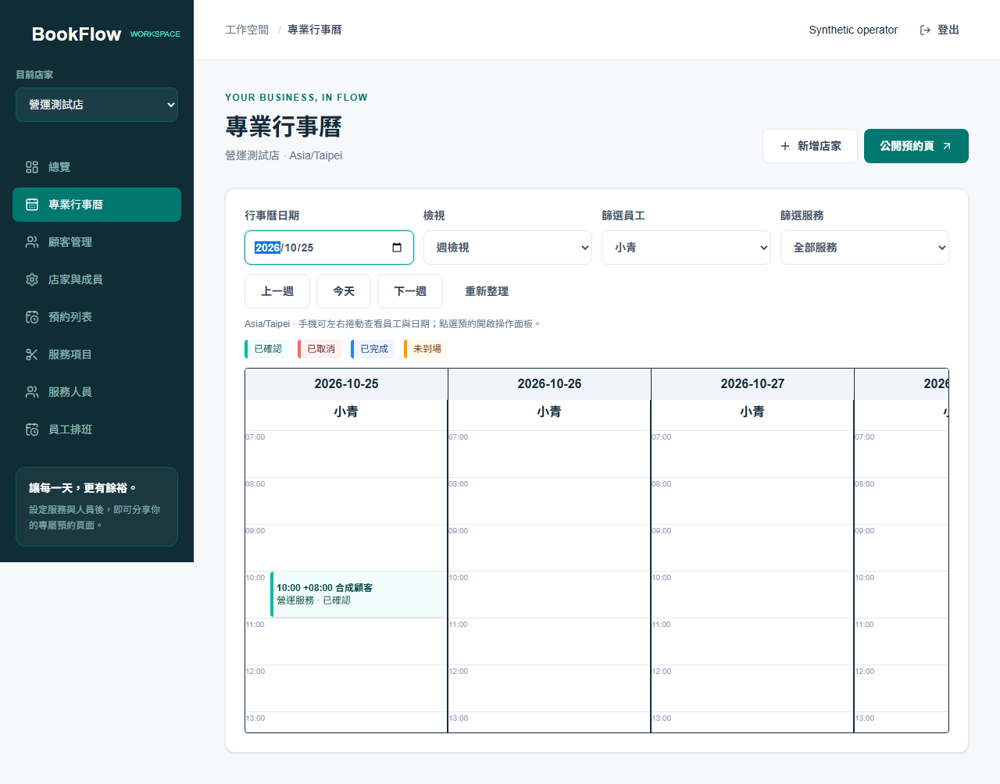

# BookFlow SaaS

BookFlow 是給工作室與服務店家的多租戶預約系統。店家可管理服務、人員與排班，顧客透過店家專屬頁面選擇可預約時段，店家則在行事曆追蹤預約與異動。



_瀏覽器測試的實際畫面，使用合成資料。_ [顧客預約頁](docs/images/public-booking.png) · [手機行事曆](docs/images/calendar-mobile.png) · [平台管理](docs/images/platform-desktop.png)

## 主要功能

- **多店家工作空間** — 店家各自管理服務、人員與成員。OWNER、ADMIN、STAFF 有不同操作範圍，平台管理權限獨立。
- **營業與員工排班** — 設定營業時間、員工服務資格、多段班表、休息、請假與服務緩衝。
- **公開預約與顧客自助** — 顧客選擇服務、人員與可用時段，預約後可透過私人連結在規則允許的期限內改期或取消。
- **預約營運** — 以日／週行事曆檢視預約，處理改期、完成、取消及未到場，並查看顧客與營運統計。
- **異動紀錄與通知** — 記錄預約狀態異動，透過交易 Outbox 排入通知，由 Worker 領取並重試。

## 技術與架構

| 層級       | 技術                                                      |
| ---------- | --------------------------------------------------------- |
| 全端       | Next.js 16 App Router、React 19、TypeScript、Tailwind CSS |
| 驗證與權限 | Better Auth、Zod、伺服器端 Session 與 Membership          |
| 排程與資料 | Luxon、Prisma、PostgreSQL 18、GiST 排他約束               |
| 驗證與交付 | Vitest、Playwright、Docker Compose、GitHub Actions        |

```text
Next.js UI → Route Handlers → 應用服務（授權、排程、預約）→ PostgreSQL
通知 Worker → PostgreSQL Outbox → Email Provider
```

同一個 Next.js 專案承載公開頁面與管理介面。Route Handlers 處理 HTTP 邊界，排程、權限與狀態轉移由應用服務處理。 [架構與資料流](docs/ARCHITECTURE.md) · [Prisma 資料模型](prisma/schema.prisma)

## 工程重點

- **租戶隔離。** 從伺服器 Session 查驗 Membership，再以租戶範圍存取資料。STAFF 只能操作綁定自身員工身分的資料。複合外鍵防止預約引用其他店家的服務、人員或顧客。 [角色與權限矩陣](docs/PERMISSIONS.md)
- **可用時段計算。** 以店家 IANA 時區計算營業、排班和休假，扣除含緩衝的既有占用。伺服器推導結束時間，以 UTC 時間點儲存預約。
- **防撞期與重複送單。** 同店寫入在取得 Tenant 列鎖後重驗，PostgreSQL 的部分 GiST 排他約束再阻擋同員工的有效占用重疊。租戶內的冪等鍵處理重試，`revision` 防止舊畫面覆寫新狀態。 [排程與並行控制](docs/TECHNICAL_DEEP_DIVE.md)

## 開發與 AI 協作

Tanci 指定求職展示目標、希望凸顯的工程重點與公開範圍。Codex 協助核對 React 表單、時段計算、租戶鎖與冪等測試，整理作品集案例及本頁。 [公開協作紀錄](https://github.com/Cizing24/developer-portfolio/blob/main/docs/AI_COLLABORATION.md) · [整合 PR](https://github.com/Cizing24/bookflow-saas/pull/1)

## 快速啟動

需要 Git、Node.js 22 LTS（至少 22.12）、npm 與 Docker Compose v2。以下指令使用 PowerShell。在 Windows 若執行原則擋住 `npm.ps1`，請改用 `npm.cmd`。

```powershell
git clone https://github.com/Cizing24/bookflow-saas.git
cd bookflow-saas
npm ci
npm run setup:env
docker compose up -d --wait
npm run db:generate
npm run db:migrate
```

若要直接體驗預約，先建立合成店家與預約。將範例改成本機密碼，至少 10 字元。

```powershell
$env:SEED_PASSWORD = 'ChooseLocalOwnerPassword'
$env:SEED_DEMO_BOOKINGS = 'true'
npm run db:seed
Remove-Item Env:SEED_PASSWORD, Env:SEED_DEMO_BOOKINGS
npm run dev
```

從 [示範店家的公開預約頁](http://localhost:3000/b/flow-studio) 建立預約，再以 `owner@bookflow.local` 和剛設定的密碼登入 [管理端](http://localhost:3000/dashboard)。若要從空白開始，直接執行 `npm run dev`，到 [註冊頁](http://localhost:3000/register) 建立店家，再新增服務與人員。

`setup:env` 在首次執行時產生本機 Session Secret。瀏覽器請使用 `localhost:3000`，與預設 Origin 一致。Compose 的 PostgreSQL 綁定 `127.0.0.1:5433`。執行 `docker compose stop` 可停止資料庫並保留資料。

<details>
<summary>Windows 使用本機 PostgreSQL</summary>

若已安裝 PostgreSQL 18，可在環境設定後以 `npm run db:local` 取代 Docker 指令，再執行生成、遷移與啟動。可用 `PG_BIN` 指定 PostgreSQL 的 `bin`。本機資料庫使用 trust 認證，僅供私人開發，且與 Compose 共用 5433 埠。

</details>

## 測試與技術文件

- [驗證報告](docs/STATUS.md) 收錄單元、PostgreSQL 整合、瀏覽器 E2E 與容器驗證。桌機、平板和手機各以 20 個請求競爭同一時段，各得 1 筆成功、19 筆衝突。 [提交 `4c91336` 的 CI](https://github.com/Cizing24/bookflow-saas/actions/runs/39655913415)
- 可用 `npm test` 執行單元測試。整合與瀏覽器測試需先遷移專用的開發或測試資料庫。 [測試與人工驗收入口](docs/RELEASE_CHECKLIST.md)
- [通知、平台管理與營運設定](docs/OPERATIONS.md) · [部署、備份與回滾](docs/DEPLOYMENT.md)

## 目前範圍

本專案提供本機展示。正式部署與正式郵件尚無驗證紀錄，訂閱與付款未實作。租戶邊界依賴應用層授權和資料庫約束，未啟用 PostgreSQL RLS。同店寫入會序列化，並行測試驗證預約正確性，生產容量仍待實測。
