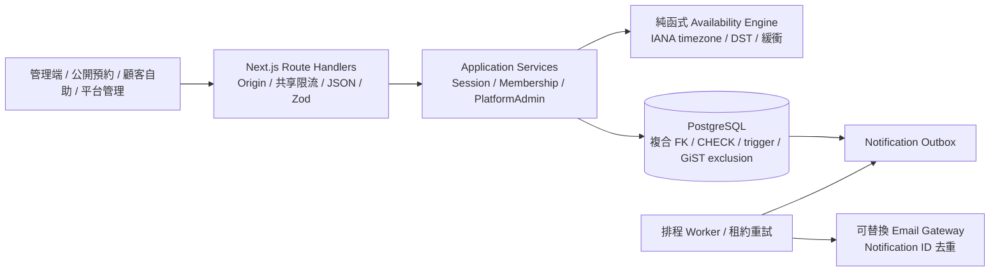
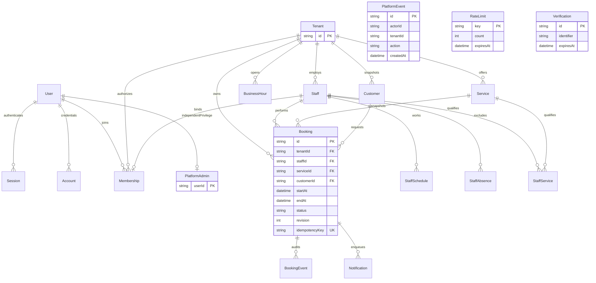
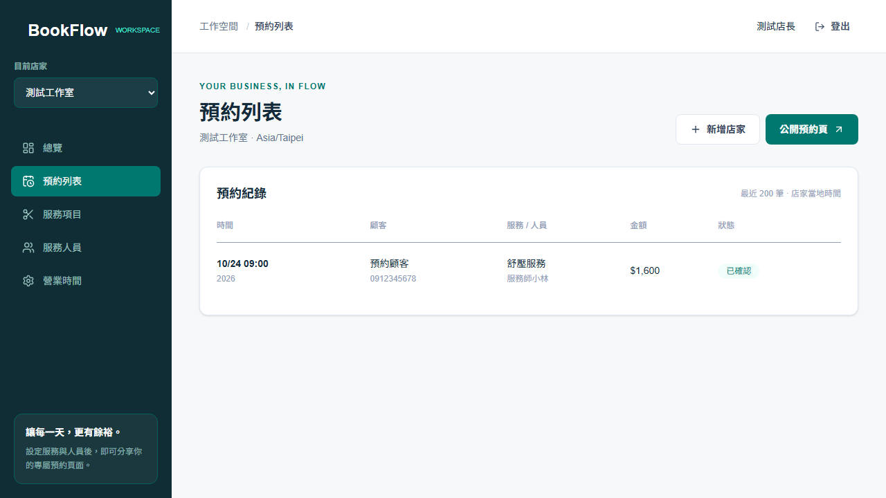
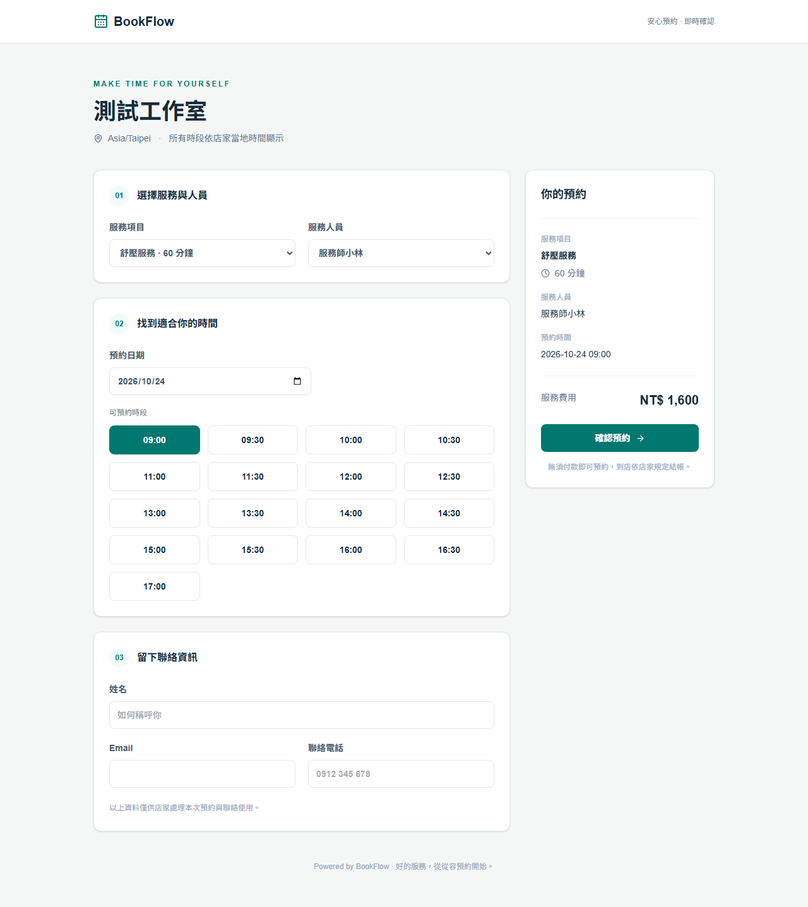
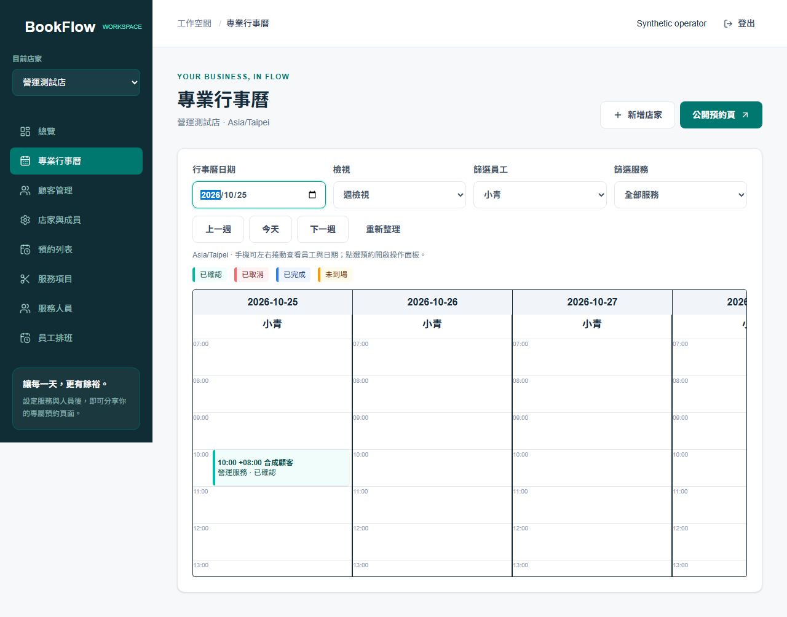
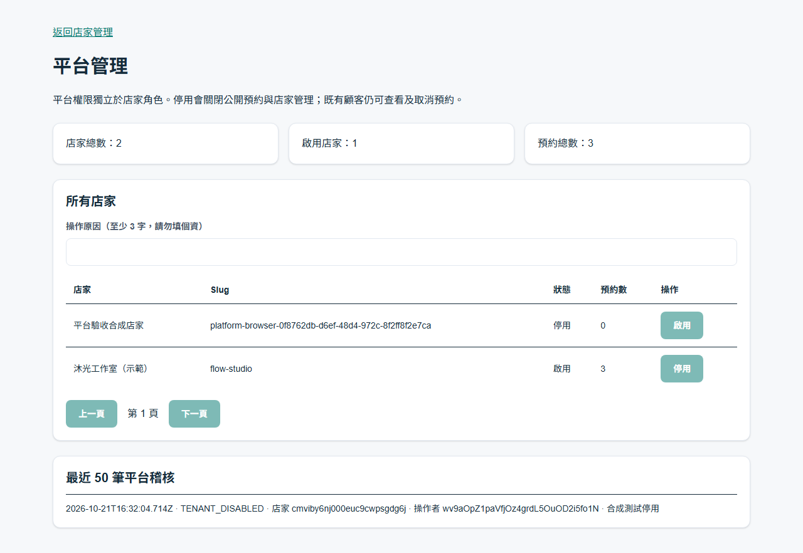

# BookFlow

**預約，從容有序。** 多租戶預約管理 SaaS，讓店家管理服務、人員與每週營業時間，顧客透過專屬網址直接預約，管理端即時看到真實資料。

以工作室、美容護理與單次服務預約為情境，處理人工訊息排程容易發生的撞期、人員資格、休假、改期與重複送單問題。實際提供多店家隔離、Owner / Admin / Staff、服務與人員、營業／排班／休假／緩衝、真實可用時段、顧客預約／取消／改期、日週行事曆、顧客管理、營運統計、稽核與交易 Outbox。

Phase 4 補齊獨立平台管理、店家啟停、共享認證限流、輸入與 HTTP 安全邊界、鍵盤焦點、Docker／CI 與部署回滾文件。訂閱金流及完整帳號營運仍在產品範圍之外。介面為臺灣繁體中文，價格幣別為新臺幣。

Repository：[Cizing24/bookflow-saas](https://github.com/Cizing24/bookflow-saas)。**沒有公開部署的 Demo URL**；本機 Demo 為 `http://localhost:3000/b/flow-studio`，依下方 Seed 建立。精確驗證與外部授權邊界見 [STATUS](docs/STATUS.md)。

## 系統架構與資料模型





`PlatformEvent` 保留 scalar actor／tenant ID，避免帳號刪除連帶抹除平台稽核。完整欄位以 [Prisma schema](prisma/schema.prisma) 與 SQL migrations 為準。

## 安全與預約一致性

- 每次管理請求從伺服器 Session 查 Membership；URL tenantId 不是權限。Staff 只操作綁定自身員工。業務關聯使用 tenantId 複合 FK，不能把其他店家的服務／人員／顧客連入預約。
- 平台權限來自獨立 PlatformAdmin，不會由 Owner 升級或反向授予店家資料權限。平台只看到基本店家狀態與計數，啟停與原因同交易稽核。
- UTC instant 儲存、IANA 店家時區計算排程。前端只顯示後端真實時段；伺服器推導 endAt／價格／服務與緩衝快照。
- 建立／改期／取消與設定共用 Tenant row lock，鎖後重新驗證；PostgreSQL partial GiST exclusion 另外阻擋同員工有效占用交集。取消自動釋放，revision 防舊畫面覆寫，終態 trigger 防復活。
- 租戶內 idempotencyKey＋請求 SHA-256 避免遺失回應重試重複建單；256-bit 私人管理 Token 僅授權對應預約。Origin、Session cookie、Zod、共享限流與安全 headers 保護 HTTP 邊界。

設計取捨與面試說明見 [TECHNICAL_DEEP_DIVE](docs/TECHNICAL_DEEP_DIVE.md)，具體權限見 [PERMISSIONS](docs/PERMISSIONS.md)。

## 畫面

以下為正式 Build 的瀏覽器測試畫面，內容是合成測試資料。







[手機行事曆驗證畫面](docs/images/calendar-mobile.png)



[手機平台管理驗證畫面](docs/images/platform-mobile.png)

## 技術

Next.js 16.4.2 App Router、React 19.3.1、TypeScript 6.0.3 strict、Prisma 7.10.1、Better Auth 1.7.12、PostgreSQL 18、Tailwind 4.3.3、shadcn/ui 基礎元件、Zod 4.6.7、Vitest 5.0.5、Playwright 1.64.1。直接依賴均固定版本，提交 package-lock.json。

選型依據：[Next.js 安裝](https://nextjs.org/docs/app/getting-started/installation)、[Prisma PostgreSQL](https://www.prisma.io/docs/orm/v7/core-concepts/supported-databases/postgresql)、[Better Auth Prisma](https://better-auth.com/docs/adapters/prisma)、[shadcn 手動安裝](https://ui.shadcn.com/docs/installation/manual)、[PostgreSQL 排他約束](https://www.postgresql.org/docs/18/rangetypes.html)、[PostgreSQL 支援版本](https://www.postgresql.org/support/versioning/)。2026-10-21 查詢時 Prisma latest 指向 8 RC，因此採穩定 7.10.1。

## 快速啟動（PowerShell）

需求：Node.js 22.12+（建議 22.23.1）、npm、Docker Compose。所有指令在 repository 根目錄執行。

Phase 4 交付位於 `phase4-production-readiness`，保留 main 與前三階段歷史。第一次取得原始碼：

```powershell
git clone --branch phase4-production-readiness https://github.com/Cizing24/bookflow-saas.git
cd bookflow-saas
```

```powershell
npm ci
npm run setup:env
docker compose up -d --wait
npm run db:generate
npm run db:migrate
npm run dev
```

開啟 **http://localhost:3000**。setup:env 只在 .env 不存在時建立檔案，並產生隨機 Session Secret。請使用 localhost，因為 Origin 與 Better Auth URL 預設固定為 http://localhost:3000；改網域或 Port 時必須同步調整 .env。資料庫預設綁定 127.0.0.1:5433，避免撞到既有 5432。

本機驗收操作：

1. 到 /register 註冊帳號（密碼至少 10 字元），會進入 /dashboard。
2. 建立店家，設定名稱、英文 Slug 與時區。
3. 在「服務項目」建立名稱、價格與分鐘數。
4. 在「服務人員」新增人員；調整「營業時間」與「員工排班」的服務資格、多段 WORK / BREAK、停班日期及預約政策。未設定專屬班表的人員沿用店家時間，所有員工使用店家時區。
5. 開啟 /b/你的-slug，選擇服務、人員、日期與時段，填寫姓名、Email、電話。
6. 取得預約成功畫面後，回到管理端「預約列表」確認紀錄；管理者可取消預約，取消後釋放包含緩衝的時段。使用「專業行事曆」查看詳情及改期／完成／未到場；「店家與成員」管理權限、截止時間與通知預覽。

## 此 Windows 環境沒有 Docker 時

本次工作環境已有 PostgreSQL 18.4 binaries，可使用隔離的專案 cluster：

```powershell
npm run setup:env
npm run db:local
npm run db:generate
npm run db:migrate
npm run dev
```

db:local 預設使用 C:/Program Files/PostgreSQL/18/bin，可透過 PG_BIN 指定安裝位置。資料僅存於被 Git 忽略的 .local-db/data，綁定 127.0.0.1:5433。它使用 trust 認證，**只適用私人本機開發**，不能作為網路共享或正式資料庫。它不修改系統既有 PostgreSQL 服務。不要同時啟動 Compose 與此 cluster，兩者使用同一個 port。

停止本機 cluster：

```powershell
& "C:/Program Files/PostgreSQL/18/bin/pg_ctl.exe" -D ".local-db/data" stop -m fast
```

Docker 使用 `docker compose stop`，保留 volume。勿任意加入 -v，以免刪除資料。

## 選用 Seed

```powershell
$env:SEED_PASSWORD = '請自行選定至少10字元的本機密碼'
$env:SEED_DEMO_BOOKINGS = 'true'
npm run db:seed
Remove-Item Env:SEED_PASSWORD
Remove-Item Env:SEED_DEMO_BOOKINGS
```

建立 owner@bookflow.local 與 /b/flow-studio 示範店家，包含兩項服務、兩位人員與週營業時間；選用 SEED_DEMO_BOOKINGS 透過真實排程服務建立最多三筆未來合成預約及對應事件／Outbox，可直接查看行事曆和統計。Seed 可重跑，不重設既有密碼或覆寫資料，禁止在 NODE_ENV=production 執行。示範資料不代表真實營運資料，不會授予平台管理權限，也不會自動寄信。

平台營運者先註冊一般帳號，再於受信任終端執行 `npm run platform:admin -- grant registered-email`，登入後到 `/platform`。撤銷用 `revoke`；每次權限改動記錄稽核。這是離線營運權限，店家成員介面沒有授予入口。

## 驗證

2026-10-22 本機實際結果：Lint／Typecheck／Production Build 通過，Unit **30 項**、PostgreSQL Integration **28 項**、正式伺服器 Playwright **15 項**通過；桌面／平板／手機 20 請求搶訂各 **1 成功、19 衝突**，全新 DB 的 6 個 Migration 重建成功。正式依賴 audit 為 0。乾淨 Linux CI 與 Docker 結果及驗證邊界見 [完整測試報告](docs/STATUS.md)。

[最終程式提交的 GitHub CI](https://github.com/Cizing24/bookflow-saas/actions/runs/39651311159) 已 **success**：乾淨安裝、Migration／Seed、全部測試、Docker tools/runtime 建置、容器 Migration、Docker healthy、DB health 與動態 Session smoke 均通過。驗證程式提交為 `6288fe71091788f4b7f34c8b99c998329bab810f`，後續僅補文件證據。本機另外完成合成 Seed 重跑、平台授權 CLI 讀回與隔離資料庫備份還原演練。

```powershell
npm run lint
npm run typecheck
npm test
npm run test:integration
npm run test:migrations
npm run test:backup
npm run build
npx playwright install chromium
npm run test:e2e
npm run format:check
npm audit --omit=dev
```

`test:migrations` 需要本機測試帳號有 CREATEDB 權限，僅建立／清除其唯一命名的暫時資料庫。Integration tests 需要已遷移的 PostgreSQL；E2E 會啟動本機伺服器或重用 3000 port 的 BookFlow。測試使用獨立名稱的 fixture 並清除自己建立的資料，請使用開發或測試資料庫，勿將 DATABASE_URL 指向 Production。Better Auth 限流保持啟用，測試會遵守 X-Retry-After 重試。

正式編譯後本機運行：

```powershell
npm run build
npm start
```

API 寫入範例需攜帶 Origin: http://localhost:3000，管理 API 另外需要登入 Session Cookie。公開 API 回應只含公開資訊及本次預約結果，不可查詢其他顧客資料。

## 專案文件

- [營運操作與 Email Provider 設定](docs/OPERATIONS.md)
- [容器、部署、備份還原與回滾](docs/DEPLOYMENT.md)
- [技術面試 Deep Dive](docs/TECHNICAL_DEEP_DIVE.md)
- [角色權限矩陣](docs/PERMISSIONS.md)
- [架構與安全邊界](docs/ARCHITECTURE.md)
- [進度、驗證證據與已知限制](docs/STATUS.md)
- [後續路線](docs/ROADMAP.md)
- [開發規則](AGENTS.md)

Windows 的 Turbopack CSS worker 本次出現提前退出，dev / build 明確使用 Next.js 支援的 Webpack。所有 TypeScript 與安全檢查仍保持啟用。

## 已知限制與技術取捨

尚未部署正式環境，也未寄送正式郵件。開發環境設定 EMAIL_PROVIDER=preview 後執行 `npm run notifications:dispatch`，Owner 可查驗 PREVIEWED；正式 Provider、排程 worker、Proxy 與監控依 OPERATIONS／DEPLOYMENT 設定。

目前無訂閱付款、Email 驗證／復原／邀請、Owner 移轉、私人連結輪替或完整隱私刪除生命週期。同店 row lock 簡化一致性，Provider 呼叫期間亦持鎖；20 請求驗證正確性，尚無容量 SLA。行事曆最多 92 天／2000 筆，列表最近 200 筆，顧客每頁 50 筆；大量資料聚合仍有最佳化空間。不是 PostgreSQL RLS；持有原始碼執行／DB 憑證的營運者屬受信任邊界。正式公開商用前須評估這些限制並完成外部部署、郵件與還原演練。

正式依賴 audit 為 0；含開發工具則有 `braces` 未修補公告造成的 5 high 相依項目。registry 尚無發布修補版，未以不相容降版或忽略機制掩蓋；公告與處理邊界見 [STATUS](docs/STATUS.md)。
