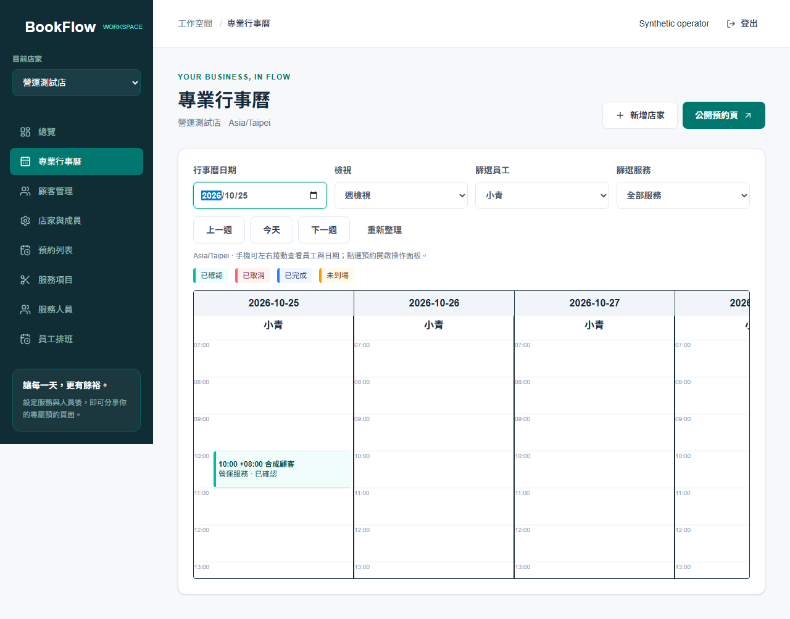
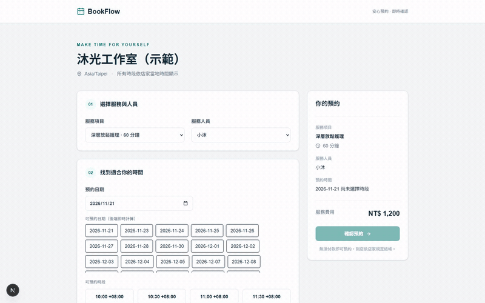
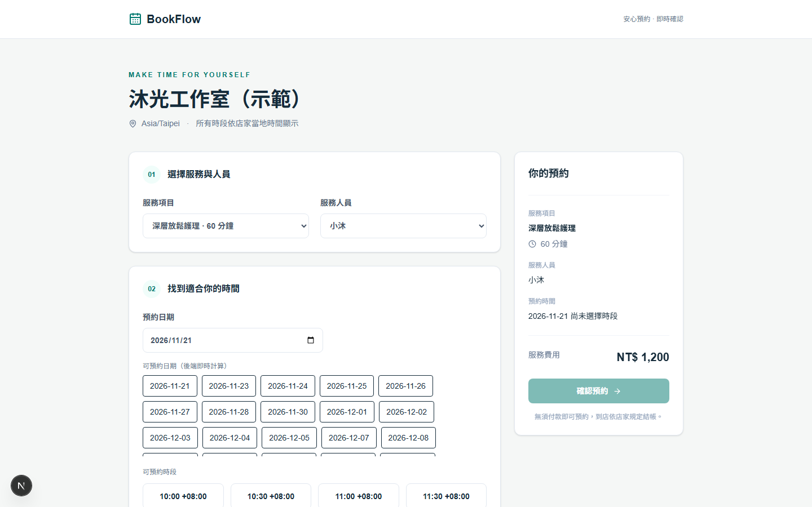
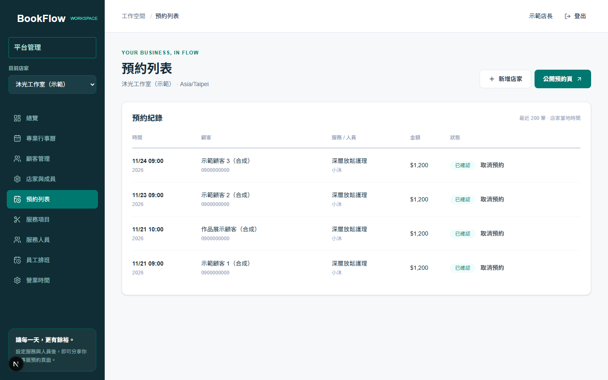
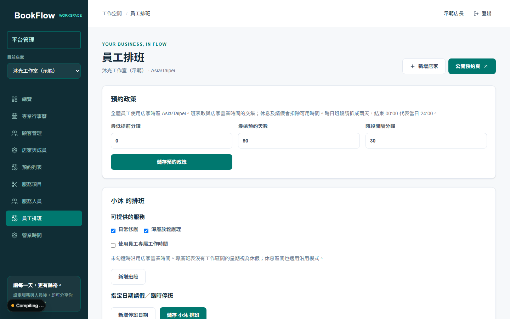
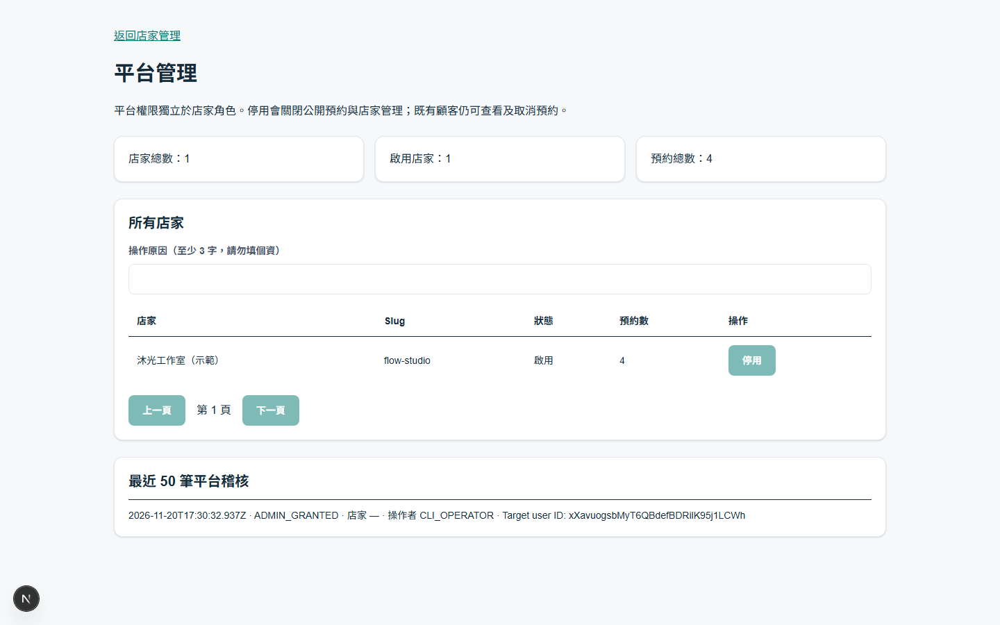
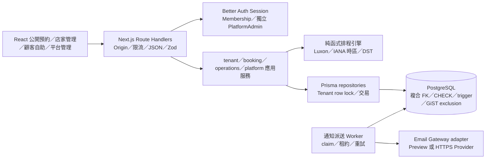

# BookFlow SaaS

給工作室與服務店家的多租戶預約系統：從員工排班、顧客選時段，到店家行事曆與預約異動，讓預約規則和營運資料保持一致。



實際系統畫面，使用合成示範資料。介面為臺灣繁體中文，價格以新臺幣呈現。

## Demo／操作展示



[觀看完整操作影片（MP4）](docs/media/demo.mp4) · [素材來源與驗證](docs/SHOWCASE_VALIDATION.md) · [本機啟動](#快速啟動powershell)

影片以本機隔離資料庫錄製，涵蓋顧客預約、管理端行事曆、預約列表、員工排班與獨立平台管理。檔案可直接下載播放；未另外發布至影片平台。通知未對外寄送。

## 解決的問題

人工訊息排程容易忽略人員服務資格、休假與服務緩衝；網路重試也可能重複建立預約。BookFlow 由後端統一計算真實可用時段，在交易中重新驗證，並以資料庫約束阻擋同員工的有效占用重疊。

店家在自己的工作空間管理服務、人員與成員；顧客從專屬網址完成單次服務預約，再依截止規則使用私人連結改期或取消。

## 功能畫面

### 顧客預約：先選服務與人員，再選可預約時段



日期與時段來自後端排程引擎，納入營業時間、資格、班表、請假、提前時間及前後緩衝。

### 店家管理：把預約結果接回營運作業



OWNER／ADMIN 管理預約與設定；STAFF 僅操作綁定員工的工作資料。顧客聯絡資料為每次預約快照，不以相同 Email 覆寫歷史資料。

### 員工排班：服務資格與可工作區間一起管理



支援多段 WORK／BREAK、指定日期停班，以及沿用店家營業時間或使用專屬班表。

### 平台管理：與店家權限分開



PlatformAdmin 可啟停店家並留下稽核，權限獨立於店家 Membership；不因此取得店家顧客及預約詳情權限。

[手機行事曆](docs/images/calendar-mobile.png) · [手機平台管理](docs/images/platform-mobile.png)

## 系統架構



這是單一 Next.js Modular Monolith；UI 和 API 共用應用服務，沒有獨立部署的前後端微服務。通知資料與預約、事件同交易寫入 PostgreSQL，Worker 由操作指令或外部排程啟動。[SVG 架構圖](docs/media/architecture.svg) · [架構與資料模型](docs/ARCHITECTURE.md) · [核對程式碼的依據](docs/SHOWCASE_VALIDATION.md#架構核對)

## Engineering Highlights／工程重點

- **多租戶與角色邊界。** 每次管理操作從伺服器 Session 查 Membership；tenantId 只是操作目標。租戶複合外鍵防止預約串入別店的服務、人員或顧客。未啟用 PostgreSQL RLS。[權限矩陣](docs/PERMISSIONS.md)
- **防撞期與重複送單。** Tenant row lock 內重讀排程，GiST 半開區間排他約束再防重疊；租戶內冪等鍵＋請求雜湊處理重試，`revision` 防止舊畫面覆寫。
- **時區與業務規則。** 以店家 IANA 時區計算排班，預約以 UTC instant 儲存。DST 跳時與重複小時、服務緩衝、取消釋放及終態限制皆有對應測試。
- **通知一致性。** Booking、BookingEvent 與 Notification 同交易提交；Worker 使用 `SKIP LOCKED`、租約與重試。寄送採 at-least-once，Gateway 需依 Notification ID 去重；SENT 只表示 Provider 接受。

## 技術決策

| 決策                            | 原因與代價                                                                                                  |
| ------------------------------- | ----------------------------------------------------------------------------------------------------------- |
| Modular Monolith                | 同一部署單元維持交易與授權流程，依 identity、tenant、booking、operations、platform 分模組。                 |
| Tenant row lock＋資料庫排他約束 | 簡化同店設定及預約競爭；代價是同店寫入序列化，20 請求正確性測試不代表容量 SLA。                             |
| SQL migrations 保留自訂約束     | Prisma schema 無法完整表達 exclusion、CHECK 與 trigger；以 append-only migrations 管理，不以 db push 取代。 |
| Outbox＋可替換 EmailProvider    | 預約提交與通知排程保持一致；外部寄送仍須重試及去重，無法承諾 exactly-once。                                 |

完整推理與邊界保留於 [TECHNICAL_DEEP_DIVE](docs/TECHNICAL_DEEP_DIVE.md)，本次沿用既有決策，未另增重複 ADR。

## Testing & Results／測試與成果

| 證據                       | 結果與適用範圍                                                                                                                                                            |
| -------------------------- | ------------------------------------------------------------------------------------------------------------------------------------------------------------------------- |
| 本次單元與整合測試         | `npm test`：6 個測試檔、30 項通過；PostgreSQL 整合測試：4 個測試檔、28 項通過。錄製 smoke 見[本次驗證](docs/SHOWCASE_VALIDATION.md)。                                     |
| 既有完整驗收（2026-10-22） | Unit 30、PostgreSQL Integration 28、Chromium E2E 15 通過；桌面、平板、手機各 20 請求競爭同一時段，均 1 成功／19 衝突。                                                    |
| 既有 CI／容器              | [main 提交 4c91336 的 CI](https://github.com/Cizing24/bookflow-saas/actions/runs/39655913415)；完整工具、DB、Migration、Build、Docker 與限制見 [STATUS](docs/STATUS.md)。 |
| 本次文件與媒體             | 檢查本地連結、圖片解碼、GIF 幀數與播放時間、MP4 串流及架構來源；不將素材錄製當成完整 E2E 重跑。                                                                           |

上述完整驗收是具日期與提交的歷史證據；本次不宣稱已重跑全部測試，也不將裝置模擬當成真機或 Safari 驗證。

## 技術組成

Next.js 16 App Router、React 19、strict TypeScript、Tailwind CSS、Better Auth、Zod、Luxon、Prisma 7、PostgreSQL 18、Vitest、Playwright、Docker Compose 與 GitHub Actions。精確版本及固定依賴以 [package.json](package.json)／[package-lock.json](package-lock.json) 為準。

## 快速啟動（PowerShell）

需求：Node.js 22.12+（建議 22.23.1）、npm、Docker Compose。所有指令在 repository 根目錄執行。

最終整合版本以 `main` 為交付分支，保留 Phase 1–4 歷史。第一次取得原始碼：

```powershell
git clone --branch main https://github.com/Cizing24/bookflow-saas.git
cd bookflow-saas
```

```powershell
npm ci
npm run setup:env
docker compose up -d --wait
npm run db:generate
npm run db:migrate
npm run dev
```

開啟 **http://localhost:3000**。setup:env 只在 .env 不存在時建立檔案，並產生隨機 Session Secret。請使用 localhost，因為 Origin 與 Better Auth URL 預設固定為 http://localhost:3000；改網域或 Port 時必須同步調整 .env。資料庫預設綁定 127.0.0.1:5433，避免撞到既有 5432。

本機驗收操作：

1. 到 /register 註冊帳號（密碼至少 10 字元），會進入 /dashboard。
2. 建立店家，設定名稱、英文 Slug 與時區。
3. 在「服務項目」建立名稱、價格與分鐘數。
4. 在「服務人員」新增人員；調整「營業時間」與「員工排班」的服務資格、多段 WORK / BREAK、停班日期及預約政策。未設定專屬班表的人員沿用店家時間，所有員工使用店家時區。
5. 開啟 /b/你的-slug，選擇服務、人員、日期與時段，填寫姓名、Email、電話。
6. 取得預約成功畫面後，回到管理端「預約列表」確認紀錄；管理者可取消預約，取消後釋放包含緩衝的時段。使用「專業行事曆」查看詳情及改期／完成／未到場；「店家與成員」管理權限、截止時間與通知預覽。

### Windows 使用本機 PostgreSQL

若已安裝 PostgreSQL 18，可使用隔離的專案 cluster：

```powershell
npm run setup:env
npm run db:local
npm run db:generate
npm run db:migrate
npm run dev
```

db:local 預設使用 C:/Program Files/PostgreSQL/18/bin，可透過 PG_BIN 指定安裝位置。資料僅存於被 Git 忽略的 .local-db/data，綁定 127.0.0.1:5433。它使用 trust 認證，**只適用私人本機開發**，不能作為網路共享或正式資料庫。它不修改系統既有 PostgreSQL 服務。不要同時啟動 Compose 與此 cluster，兩者使用同一個 port。

停止本機 cluster：

```powershell
& "C:/Program Files/PostgreSQL/18/bin/pg_ctl.exe" -D ".local-db/data" stop -m fast
```

Docker 使用 `docker compose stop`，保留 volume。勿任意加入 -v，以免刪除資料。

### 選用 Seed

```powershell
$env:SEED_PASSWORD = '請自行選定至少10字元的本機密碼'
$env:SEED_DEMO_BOOKINGS = 'true'
npm run db:seed
Remove-Item Env:SEED_PASSWORD
Remove-Item Env:SEED_DEMO_BOOKINGS
```

建立 owner@bookflow.local 與 /b/flow-studio 示範店家，包含兩項服務、兩位人員與週營業時間；選用 SEED_DEMO_BOOKINGS 透過真實排程服務建立最多三筆未來合成預約及對應事件／Outbox，可直接查看行事曆和統計。Seed 可重跑，不重設既有密碼或覆寫資料，禁止在 NODE_ENV=production 執行。示範資料不代表真實營運資料，不會授予平台管理權限，也不會自動寄信。

平台營運者先註冊一般帳號，再於受信任終端執行 `npm run platform:admin -- grant registered-email`，登入後到 `/platform`。撤銷用 `revoke`；每次權限改動記錄稽核。這是離線營運權限，店家成員介面沒有授予入口。

## 驗證指令

```powershell
npm run lint
npm run typecheck
npm test
npm run test:integration
npm run test:migrations
npm run test:backup
npm run build
npx playwright install chromium
npm run test:e2e
npm run format:check
npm audit --omit=dev
```

`test:migrations` 需要本機測試帳號有 CREATEDB 權限，僅建立／清除其唯一命名的暫時資料庫。Integration tests 需要已遷移的 PostgreSQL；E2E 會啟動本機伺服器或重用 3000 port 的 BookFlow。測試使用獨立名稱的 fixture 並清除自己建立的資料，請使用開發或測試資料庫，勿將 DATABASE_URL 指向 Production。Better Auth 限流保持啟用，測試會遵守 X-Retry-After 重試。

正式編譯後本機運行：

```powershell
npm run build
npm start
```

API 寫入範例需攜帶 Origin: http://localhost:3000，管理 API 另外需要登入 Session Cookie。公開 API 回應只含公開資訊及本次預約結果，不可查詢其他顧客資料。

## 專案文件

- [營運操作與 Email Provider 設定](docs/OPERATIONS.md)
- [容器、部署、備份還原與回滾](docs/DEPLOYMENT.md)
- [技術面試 Deep Dive](docs/TECHNICAL_DEEP_DIVE.md)
- [角色權限矩陣](docs/PERMISSIONS.md)
- [架構與安全邊界](docs/ARCHITECTURE.md)
- [進度、驗證證據與已知限制](docs/STATUS.md)
- [最終整合檢查與人工驗收](docs/RELEASE_CHECKLIST.md)
- [後續路線](docs/ROADMAP.md)
- [開發規則](AGENTS.md)

Windows 的 Turbopack CSS worker 本次出現提前退出，dev / build 明確使用 Next.js 支援的 Webpack。所有 TypeScript 與安全檢查仍保持啟用。

## 專案狀態與限制

已實作多租戶預約、員工排班、顧客自助、行事曆、營運統計、角色權限、平台啟停、稽核與通知 Outbox。素材均為合成資料；Email Preview 僅供本機檢查，不代表已寄送正式郵件。

訂閱付款、Email 驗證／復原／邀請、Owner 移轉、私人連結輪替與完整隱私刪除生命週期尚未實作。真機、Safari／Firefox、正式郵件投遞、生產容量與正式環境還原仍未驗證。

公開 Demo 部署另由尚未合併的 [PR #3](https://github.com/Cizing24/bookflow-saas/pull/3) 維護，其程式與本分支不同；本次文件工作未合併該 PR，也未部署或修改公開服務。既有完整驗收與安全掃描是歷史結果，當前相依安全狀態應重新執行 audit。

<details>
<summary>既有開發協作紀錄</summary>

Tanci 指定求職展示目標、希望凸顯的工程重點與公開範圍。Codex 協助核對 React 表單、時段計算、租戶鎖與冪等測試，整理作品集案例及本頁。 [公開協作紀錄](https://github.com/Cizing24/developer-portfolio/blob/main/docs/AI_COLLABORATION.md) · [整合 PR](https://github.com/Cizing24/bookflow-saas/pull/1)

</details>
