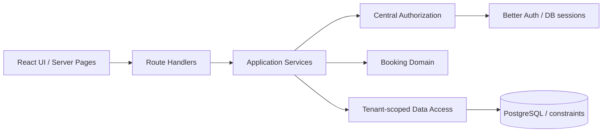

# BookFlow 架構

## 系統邊界

Phase 1 是單一 Next.js 程序、單一 PostgreSQL 的 Modular Monolith。所有業務資料持久化於 PostgreSQL，公開頁面不需要顧客帳號。沒有瀏覽器假資料或記憶體預約儲存。

- `src/app`：路由、HTTP 邊界、Server Pages；不承載預約規則。
- `src/components`：互動表單、SaaS 管理介面；只呼叫 API。
- `src/components/ui`：依 shadcn/ui 手動安裝方式建立的 Button、Input、Card，使用 Radix Slot、CVA、Tailwind。
- `src/modules/identity`：Session 解析與每次請求的 Membership / Role 檢查。
- `src/modules/tenant`：店家、服務、人員、每週營業時間的 Application Services 與 scoped Repository。
- `src/modules/booking/domain.ts`：純函式時段計算，無資料庫或 HTTP 依賴。
- `src/modules/booking/service.ts`：公開預約 use case、重新驗證、交易協調。
- `src/modules/booking/repository.ts`：公開資料投影、租戶鎖定交易與預約持久化；只對公開頁輸出店名、服務與人員等公開資訊。
- `src/lib`：Prisma、Better Auth、錯誤轉換與基礎共用元件。

## 身分與租戶授權

Better Auth 負責 Email / Password 註冊登入、密碼雜湊、資料庫 Session、Cookie 與登出撤銷。Session 有效期 7 天、每 24 小時更新。正式 HTTPS 環境由 Better Auth 使用 Secure Cookie；本機 HTTP 僅用於開發。登入、註冊有 Better Auth 限流。

每個管理端 use case 都先呼叫 `authorize(tenantId, write)`，根據伺服器取得的 Session userId 查詢 Membership，不能信任請求中的 userId / role。沒有 Membership 回應 403，未登入回應 401。UI 的按鈕顯示只是操作提示，真正權限在伺服器。

| Role  | 讀取自己所屬店家 | 管理服務、人員、營業時間 |
| ----- | ---------------- | ------------------------ |
| OWNER | 是               | 是                       |
| ADMIN | 是               | 是                       |
| STAFF | 是               | 否                       |

Staff 是可預約的服務人員資料；Membership 是登入帳號的店家權限。兩者在 Phase 1 不強制一對一，邀請與帳號綁定留到下一階段。建立新店家者自動取得 OWNER。

所有 Service、Staff、Customer、Booking、BusinessHour 皆有 tenantId。寫入查詢採 `tenantId_id` 複合條件。Booking 的 Service / Staff / Customer 關聯使用含 tenantId 的複合外鍵，資料庫也會拒絕跨租戶關聯。資料庫帳號是受信任的應用程序帳號；目前沒有 PostgreSQL RLS，不宣稱 DB 超級使用者也受到 tenant 隔離。

## 預約一致性

1. Zod 驗證輸入；endAt 不屬於輸入契約。
2. 依 slug 取得店家，驗證 serviceId / staffId 均為此店家且啟用。
3. 依 IANA 時區、週營業時間、服務分鐘數、現有有效預約，計算未來 90 天、每 30 分鐘的可預約起始時間。
4. 確認送出的 startAt 確實屬於後端計算結果。
5. 交易中鎖定 Tenant row，重新讀取服務狀態、長度、人員、營業時間與當下時間。管理設定的寫入也取得相同鎖，避免停用／營業時間修改與預約競態。
6. 建立獨立 Customer 聯絡資訊快照與 Booking；價格、服務名稱一併保留快照。失敗時整筆回滾。
7. PostgreSQL `btree_gist` + partial exclusion constraint 對有效 Booking 的 `tenantId / staffId / tstzrange(startAt,endAt,'[)')` 排他；即使略過應用驗證、同時寫入，也不能重疊。相鄰預約合法，CANCELLED 不占用。
8. 排他衝突轉成 HTTP 409；顧客可重新選時段。

Tenant row lock 是 Phase 1 的簡潔一致性選擇，同店寫入會序列化，適合小型服務店家。增加吞吐量時，需在保留排他約束與設定一致性的前提下改為更細的鎖。

## 時間、價格與聯絡資料

- 使用 PostgreSQL timestamptz 儲存瞬間，API 使用 UTC ISO 字串，前端依店家時區顯示。
- BusinessHour 使用當地星期（0 為週日）與午夜起算分鐘數；支援每天一段，結束可為 24:00，不支援跨日營業。
- Luxon 處理時區與 DST；跳過不存在的當地時間。秋季重複時間目前每個牆上時間提供單一 offset，完整員工排程引擎再擴充。
- 價格為整數新臺幣，禁止負數；服務長度 15–480 分鐘且為 15 的倍數。
- 每筆 Booking 使用獨立 Customer 快照。匿名顧客輸入相同 Email 不會更新舊預約聯絡資料；跨預約 CRM 合併需身分驗證與另外的授權設計。

## 安全與運行限制

寫入 API 嚴格核對 Origin，拒絕跨來源寫入。Prisma 參數化查詢，無拼接 SQL。錯誤回應不暴露資料庫訊息；一般日誌不輸出顧客聯絡資訊或憑證。HTTP 加入 nosniff、Referrer-Policy、frame deny。

目前認證限流使用單程序記憶體；公開預約尚無 CAPTCHA、共享限流或付款，這些是公開 Production 上線前的必要加固項目。尚未提供 Email 驗證、忘記密碼、通知、稽核事件、備份還原與刪除資料生命週期；此交付驗證的是本機 MVP，沒有部署 Production。
