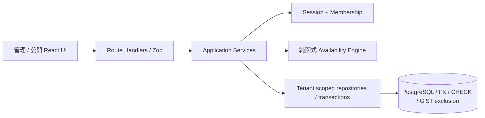

# BookFlow 架構

## 系統邊界

沿用 Phase 1 Next.js Modular Monolith、PostgreSQL、Better Auth 與 strict TypeScript，沒有重建專案。



- `src/app`：HTTP 與頁面邊界；`src/components`：繁體中文介面，不持有預約規則。
- `modules/identity`：每次管理 use case 檢查伺服器 Session 與 Membership。OWNER / ADMIN 可寫，STAFF 僅讀；不是只隱藏按鈕。
- `modules/tenant`：店家、服務、人員、營業時間、排班、預約政策與取消預約。
- `modules/booking/domain.ts`：獨立、可注入 `now` 的 `availability()` 純函式；保留 Phase 1 `computeSlots()` 契約。
- `modules/booking/service.ts`：公開日期 / 時段查詢、冪等驗證、重新計算與建立預約交易。
- `modules/booking/repository.ts`：明確公開投影、排程資料讀取、占用查詢與 Tenant row lock。

## 資料模型與租戶隔離

保留 User、Tenant、Membership、Staff、Service、Customer、Booking、BusinessHour 及認證資料表。新增：

| 模型 / 欄位                          | 用途                                                    |
| ------------------------------------ | ------------------------------------------------------- |
| StaffService                         | 含 tenantId 的 staff / service 複合外鍵，員工可服務項目 |
| StaffSchedule                        | 員工每週多段 WORK / BREAK，當地星期與分鐘               |
| StaffAbsence                         | 員工指定當地日期的全日／部分停班、請假、休假            |
| Staff.customSchedule                 | false 沿用店家營業時間；true 使用個別工作班段           |
| Tenant policy                        | minNoticeMinutes、maxAdvanceDays、slotIntervalMinutes   |
| Service buffers                      | 服務前後各 0–240 分鐘                                   |
| Booking buffers / occupied endpoints | 保留建立當時緩衝快照，Trigger 計算實際占用時間          |
| Booking idempotencyKey / requestHash | 租戶內唯一重試鍵與正規化請求 SHA-256                    |

Service / Staff / Customer / Booking 及新增排班關聯的查詢皆限制 tenantId；複合外鍵拒絕跨店關聯。管理者只能修改自己有管理權限的店家。Staff 是服務人員，Membership 是登入權限，兩者沒有強制綁定。資料庫連線是受信任的應用帳號，尚無 RLS，不能宣稱資料庫超級使用者也受到租戶隔離。

Migration 將既有人員與服務完整對應，保留 Phase 1 行為；經管理 API 新增人員／服務時，也建立與當時同店資源的預設對應。之後管理者可在「員工排班」取消資格；資格為空代表不能提供任何服務。Seed 僅在新建示範店時建立對應，重跑不覆蓋管理者選擇。

## 排程與時區政策

1. 唯一權威時區是 Tenant 的 IANA timezone。員工沒有可分歧的獨立時區；員工在其他地區仍依店家時間編輯班表。
2. 每週星期為當地星期（0 週日），分鐘範圍 0–1440。店家 BusinessHour 保留每天一段；員工可多段工作與休息。
3. 有效工作時間 = 店家營業時間與員工工作區間的交集，再扣除 BREAK 與指定日期停班。沿用模式直接使用店家營業時間，但仍套用 BREAK / 停班。專屬模式未設定 WORK 的星期視為休假。
4. 不支援單筆跨午夜班段。跨日營業應拆成兩個日期／星期；UI 的結束 00:00 代表該日 24:00。完整占用範圍必須落在同日連續的有效工作區間內，不能穿越午休、請假或關店。
5. 以服務起點套用最低提前分鐘（預設 0）、最遠當地日期（預設含今日至第 90 天，可設 1–365）、時段格線（預設 30 分，可設 5–120）。格線以每個工作區間起點為基準。起點必須嚴格晚於現在。
6. 服務時間與前後緩衝皆為實際經過分鐘。引擎沿當地日對應的真實 UTC 分鐘建立連續區間；春季不存在時間不產生候選值，秋季重複時間產生兩個不同 UTC 瞬間，休息與停班套用兩個 offset。UI 時段顯示 `HH:mm ±HH:mm`，確認畫面保留店家時區與 offset。
7. API / PostgreSQL timestamptz 儲存 UTC 瞬間，服務 endAt 由伺服器推導。服務名稱、整數新臺幣價格、Customer 聯絡資訊與緩衝皆為快照。匿名預約不合併或改寫舊 Customer。

## 資料庫防雙重預約

保留初始 Migration 的 `btree_gist`，第三個 Migration 擴充有效 Booking 的排他範圍：

```sql
EXCLUDE USING gist (
  "tenantId" WITH =,
  "staffId" WITH =,
  tstzrange("occupiedStartAt", "occupiedEndAt", '[)') WITH &&
) WHERE (status = 'CONFIRMED')
```

`BEFORE INSERT OR UPDATE` Trigger 強制從 startAt / endAt 與緩衝快照重算 occupiedStartAt / occupiedEndAt；直接填假的占用端點也無法繞過。CHECK 要求占用端點非空、服務正長度與合法緩衝。Prisma 端點欄位標為 optional 是為讓 INSERT 交給 Trigger 填值，資料庫實際透過 CHECK 禁止空值。

半開區間允許占用範圍恰好相鄰；只在服務起迄相鄰但緩衝重疊時仍會拒絕。更新 CANCELLED 後 partial exclusion 自動釋放整段占用，重複取消不產生額外狀態變更。

所有設定修改、取消與建立預約都取得同一 Tenant row lock。預約在鎖內重新讀取政策、服務、人員資格、營業時間、班表、停班、有效 Booking 與當下時間，通過後才建立 Customer / Booking。設定與預約的先後由鎖取得順序決定。設定修改不追溯取消既有預約。

READ COMMITTED 的鎖後讀取可看到上一筆交易提交；Tenant lock 將同店寫入序列化，跨店獨立。這是沿用的低複雜度一致性方案，尚未驗證大型店家的生產吞吐量。Database exclusion 仍保護繞過應用鎖的其他寫入者。GiST 在直接大量併發 INSERT 時可能產生 `23P01` 排他違反或 `40P01` 死結回滾；兩者都不留下重疊資料。應用將已辨識的排他／交易衝突轉為中文 409，不向顧客輸出 SQL 或內部資訊。

Prisma 7.10.1 不能在 schema 完整表達 exclusion / trigger / CHECK，使用 append-only SQL Migration；不使用 db push 代替。既有兩個 Migration 沒有修改。第三個 Migration 以交易包住新增欄位、回填及約束替換；套用時會鎖表，正式上線須另外安排部署窗口與授權。

官方設計依據：[PostgreSQL Range Types](https://www.postgresql.org/docs/18/rangetypes.html)、[btree_gist](https://www.postgresql.org/docs/18/btree-gist.html)、[Prisma unsupported database features / custom migration](https://docs.prisma.io/docs/orm/prisma-migrate/workflows/unsupported-database-features)。

## API 與冪等契約

- `GET /api/public/:slug/dates?serviceId=...&staffId=...`：後端計算有時段的當地日期列表；一次取得範圍內 occupied ranges，再逐日計算，不逐日查詢 DB。
- `GET /api/public/:slug/slots?serviceId=...&staffId=...&date=yyyy-MM-dd`：UTC ISO 起點陣列。前端只顯示回傳的日期和時段，不自行生成候選時間。
- `POST /api/public/:slug/bookings`：既有聯絡欄位與起點，可附 body `idempotencyKey` 或 `Idempotency-Key` header。兩者同時存在須一致；只接受 16–128 字元英數、底線、連字號。endAt 不是輸入契約。
- `POST /api/tenants/:tenantId/schedule`：原子取代單一員工的 `{ staffId, customSchedule, serviceIds, schedule, absences }`；同星期同類重疊區間會拒絕。WORK / BREAK 互相重疊是正常的扣除語意。
- `POST /api/tenants/:tenantId/policy`：修改三個預約政策整數。
- `POST /api/tenants/:tenantId/cancel`：`{ id }`，僅 OWNER / ADMIN 可取消同店預約。

重試鍵在同店唯一且隨 Booking 保留，不會因時間失效、服務停用或取消而建立新預約。相同鍵＋相同正規化內容回傳同筆編號與目前狀態；相同鍵＋不同內容回應 409。不同租戶的相同鍵互不影響。Hash 不寫入一般日誌或回傳公開 API。沒有過期刪除工作；未來資料保留流程需維持此契約。

公開 UI 為每個確定內容的提交產生 crypto.randomUUID，同頁網路失敗重試沿用同鍵；改內容或另約一次才換鍵。重試讀到 CANCELLED 時明確顯示已取消，不顯示保留成功。E2E 會經真實伺服器建單後刻意丟棄回應，再透過畫面重送，驗證回傳同筆編號。API 對 Phase 1 舊客戶端允許不帶鍵，這類請求只受防重疊保護，沒有跨時段重試去重保證。需要網路重試的外部整合必須自行保存並重送鍵。

## 安全與驗證邊界

保留同來源寫入保護、參數化 SQL、安全 HTTP headers、Better Auth Session / 登出撤銷、角色與租戶隔離。測試只允許 localhost 開發／測試 PostgreSQL、使用唯一合成 fixture 並清除自身資料；Migration 重建測試只建立及刪除其隨機命名資料庫，需要本機測試帳號有 CREATEDB 權限，不代表正式 runtime 應取得此權限。

Windows 此次 Turbopack CSS worker 反覆在連線前退出，故 npm dev / build 明確使用 Next.js 支援的 Webpack 路徑；沒有關閉 TypeScript、安全檢查或更換框架／依賴。

本階段沒有 Production 部署、付款、寄信、共享公開限流、完整稽核、改期、邀請管理、備份還原與資料保留刪除。公開營運前仍需完成這些適用的營運加固，不把 20 請求正確性測試視為生產容量驗收。
