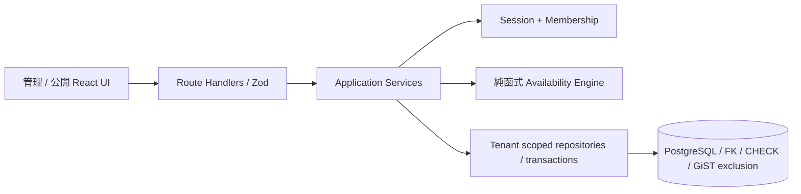
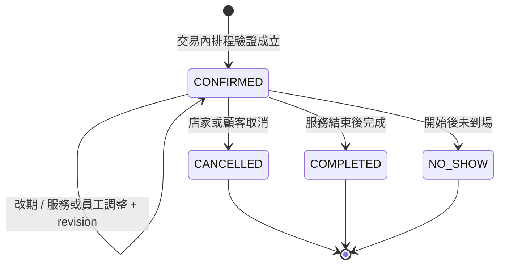

# BookFlow 架構

## Phase 4 增量

- 新增 `modules/platform`、`/platform` 與 `/api/platform`。獨立 PlatformAdmin 授權，不擴張 Membership Role；平台基本資料投影、25 店／頁、Repeatable Read 統計快照、最近 50 稽核。
- 第五個 append-only Migration 新增 Tenant.active、PlatformAdmin、PlatformEvent；第六個對齊新外鍵 ON UPDATE CASCADE，不改已套用的 Migration。啟停以 Tenant row lock 與 expectedActive 驗證，同 transaction 記錄前後狀態、原因、操作者與 UTC 時間。
- 公開讀取只選 active tenant；建單鎖後 schedulingContext 再驗 active，解決停用／建單競爭。店家管理 authorization/access 檢查 active。設定 repository 鎖後重驗 actor Membership，避免等待期間角色撤銷仍成功。既有顧客可讀取／取消；改期需 active。
- Better Auth endpoint 原限流保留，HTTP POST 增加 PostgreSQL 共享限流及 Origin；業務 JSON stream 上限 64 KiB，所有業務 API 回應 no-store／no-referrer；安全 Cookie 依 HTTPS Origin，新增基本 CSP／Permissions-Policy。
- `/health` 讀實際 schema／DB、失敗 503。Docker tools/runtime、CI 容器 smoke、正式 env 範本與部署／回滾／備份還原手冊見 [DEPLOYMENT](DEPLOYMENT.md)。Docker build 使用 BOOKFLOW_STANDALONE=true，本機 npm start 保持標準 Next server。
- UI 沿用同一 Button／Input／Card、色彩與 spacing，補全域 focus-visible／reduced-motion、平台 loading／empty／error、手機可捲動表格、行事曆詳情鍵盤聚焦／Escape／返回原事件焦點。詳情為頁內 region。

完整工程原理與取捨見 [TECHNICAL_DEEP_DIVE](TECHNICAL_DEEP_DIVE.md)。以下保留前三階段架構與契約；若歷史段落提到「未提供備份文件」，本階段已補文件，正式演練仍需依 STATUS 查驗。

## 系統邊界

沿用 Phase 1 Next.js Modular Monolith、PostgreSQL、Better Auth 與 strict TypeScript，沒有重建專案。



- `src/app`：HTTP 與頁面邊界；`src/components`：繁體中文介面，不持有預約規則。
- `modules/identity`：每次管理 use case 檢查伺服器 Session 與 Membership。OWNER 管理設定與成員；OWNER / ADMIN 管理排班、服務及預約；STAFF 只讀寫綁定的自身預約，未綁定時無工作資料。詳見 PERMISSIONS。
- `modules/tenant`：店家、服務、人員、營業時間、排班、預約政策與取消預約。
- `modules/booking/domain.ts`：獨立、可注入 `now` 的 `availability()` 純函式；保留 Phase 1 `computeSlots()` 契約。
- `modules/booking/service.ts`：公開日期 / 時段查詢、冪等驗證、重新計算與建立預約交易。
- `modules/booking/repository.ts`：明確公開投影、排程資料讀取、占用查詢與 Tenant row lock。

## 資料模型與租戶隔離

保留 User、Tenant、Membership、Staff、Service、Customer、Booking、BusinessHour 及認證資料表。新增：

| 模型 / 欄位                          | 用途                                                    |
| ------------------------------------ | ------------------------------------------------------- |
| StaffService                         | 含 tenantId 的 staff / service 複合外鍵，員工可服務項目 |
| StaffSchedule                        | 員工每週多段 WORK / BREAK，當地星期與分鐘               |
| StaffAbsence                         | 員工指定當地日期的全日／部分停班、請假、休假            |
| Staff.customSchedule                 | false 沿用店家營業時間；true 使用個別工作班段           |
| Tenant policy                        | minNoticeMinutes、maxAdvanceDays、slotIntervalMinutes   |
| Service buffers                      | 服務前後各 0–240 分鐘                                   |
| Booking buffers / occupied endpoints | 保留建立當時緩衝快照，Trigger 計算實際占用時間          |
| Booking idempotencyKey / requestHash | 租戶內唯一重試鍵與正規化請求 SHA-256                    |

Service / Staff / Customer / Booking 及新增排班關聯的查詢皆限制 tenantId；複合外鍵拒絕跨店關聯。管理者只能修改自己有管理權限的店家。Staff 是服務人員，Membership 是登入權限，Phase 3 以可空 staffId 與租戶複合外鍵綁定，一名服務人員最多綁定一名成員；STAFF 未綁定時查詢回傳空工作資料。資料庫連線是受信任的應用帳號，尚無 RLS，不能宣稱資料庫超級使用者也受到租戶隔離。

Migration 將既有人員與服務完整對應，保留 Phase 1 行為；經管理 API 新增人員／服務時，也建立與當時同店資源的預設對應。之後管理者可在「員工排班」取消資格；資格為空代表不能提供任何服務。Seed 僅在新建示範店時建立對應，重跑不覆蓋管理者選擇。

## 排程與時區政策

1. 唯一權威時區是 Tenant 的 IANA timezone。員工沒有可分歧的獨立時區；員工在其他地區仍依店家時間編輯班表。
2. 每週星期為當地星期（0 週日），分鐘範圍 0–1440。店家 BusinessHour 保留每天一段；員工可多段工作與休息。
3. 有效工作時間 = 店家營業時間與員工工作區間的交集，再扣除 BREAK 與指定日期停班。沿用模式直接使用店家營業時間，但仍套用 BREAK / 停班。專屬模式未設定 WORK 的星期視為休假。
4. 不支援單筆跨午夜班段。跨日營業應拆成兩個日期／星期；UI 的結束 00:00 代表該日 24:00。完整占用範圍必須落在同日連續的有效工作區間內，不能穿越午休、請假或關店。
5. 以服務起點套用最低提前分鐘（預設 0）、最遠當地日期（預設含今日至第 90 天，可設 1–365）、時段格線（預設 30 分，可設 5–120）。格線以每個工作區間起點為基準。起點必須嚴格晚於現在。
6. 服務時間與前後緩衝皆為實際經過分鐘。引擎沿當地日對應的真實 UTC 分鐘建立連續區間；春季不存在時間不產生候選值，秋季重複時間產生兩個不同 UTC 瞬間，休息與停班套用兩個 offset。UI 時段顯示 `HH:mm ±HH:mm`，確認畫面保留店家時區與 offset。
7. API / PostgreSQL timestamptz 儲存 UTC 瞬間，服務 endAt 由伺服器推導。服務名稱、整數新臺幣價格、Customer 聯絡資訊與緩衝皆為快照。匿名預約不合併或改寫舊 Customer。

## 資料庫防雙重預約

保留初始 Migration 的 `btree_gist`，第三個 Migration 擴充有效 Booking 的排他範圍：

```sql
EXCLUDE USING gist (
  "tenantId" WITH =,
  "staffId" WITH =,
  tstzrange("occupiedStartAt", "occupiedEndAt", '[)') WITH &&
) WHERE (status = 'CONFIRMED')
```

`BEFORE INSERT OR UPDATE` Trigger 強制從 startAt / endAt 與緩衝快照重算 occupiedStartAt / occupiedEndAt；直接填假的占用端點也無法繞過。CHECK 要求占用端點非空、服務正長度與合法緩衝。Prisma 端點欄位標為 optional 是為讓 INSERT 交給 Trigger 填值，資料庫實際透過 CHECK 禁止空值。

半開區間允許占用範圍恰好相鄰；只在服務起迄相鄰但緩衝重疊時仍會拒絕。更新 CANCELLED 後 partial exclusion 自動釋放整段占用，重複取消不產生額外狀態變更。

所有設定修改、取消、改期與建立預約都取得同一 Tenant row lock。預約在鎖內重新讀取政策、服務、人員資格、營業時間、班表、停班、有效 Booking 與當下時間，通過後才建立 Customer / Booking。設定與預約的先後由鎖取得順序決定。設定修改不追溯取消既有預約。

READ COMMITTED 的鎖後讀取可看到上一筆交易提交；Tenant lock 將同店寫入序列化，跨店獨立。這是沿用的低複雜度一致性方案，尚未驗證大型店家的生產吞吐量。Database exclusion 仍保護繞過應用鎖的其他寫入者。GiST 在直接大量併發 INSERT 時可能產生 `23P01` 排他違反或 `40P01` 死結回滾；兩者都不留下重疊資料。應用將已辨識的排他／交易衝突轉為中文 409，不向顧客輸出 SQL 或內部資訊。

Prisma 7.10.1 不能在 schema 完整表達 exclusion / trigger / CHECK，使用 append-only SQL Migration；不使用 db push 代替。既有兩個 Migration 沒有修改。第三個 Migration 以交易包住新增欄位、回填及約束替換；套用時會鎖表，正式上線須另外安排部署窗口與授權。

官方設計依據：[PostgreSQL Range Types](https://www.postgresql.org/docs/18/rangetypes.html)、[btree_gist](https://www.postgresql.org/docs/18/btree-gist.html)、[Prisma unsupported database features / custom migration](https://docs.prisma.io/docs/orm/prisma-migrate/workflows/unsupported-database-features)。

## API 與冪等契約

- `GET /api/public/:slug/dates?serviceId=...&staffId=...`：後端計算有時段的當地日期列表；一次取得範圍內 occupied ranges，再逐日計算，不逐日查詢 DB。
- `GET /api/public/:slug/slots?serviceId=...&staffId=...&date=yyyy-MM-dd`：UTC ISO 起點陣列。前端只顯示回傳的日期和時段，不自行生成候選時間。
- `POST /api/public/:slug/bookings`：既有聯絡欄位與起點，可附 body `idempotencyKey` 或 `Idempotency-Key` header。兩者同時存在須一致；只接受 16–128 字元英數、底線、連字號。endAt 不是輸入契約。
- `POST /api/tenants/:tenantId/schedule`：原子取代單一員工的 `{ staffId, customSchedule, serviceIds, schedule, absences }`；同星期同類重疊區間會拒絕。WORK / BREAK 互相重疊是正常的扣除語意。
- `POST /api/tenants/:tenantId/policy`：修改三個預約政策整數。
- `POST /api/tenants/:tenantId/cancel`：`{ id }`，僅 OWNER / ADMIN 可取消同店預約。

重試鍵在同店唯一且隨 Booking 保留，不會因時間失效、服務停用或取消而建立新預約。相同鍵＋相同正規化內容回傳同筆編號與目前狀態；相同鍵＋不同內容回應 409。不同租戶的相同鍵互不影響。Hash 不寫入一般日誌或回傳公開 API。沒有過期刪除工作；未來資料保留流程需維持此契約。

公開 UI 為每個確定內容的提交產生 crypto.randomUUID，同頁網路失敗重試沿用同鍵；改內容或另約一次才換鍵。重試讀到 CANCELLED 時明確顯示已取消，不顯示保留成功。E2E 會經真實伺服器建單後刻意丟棄回應，再透過畫面重送，驗證回傳同筆編號。API 對 Phase 1 舊客戶端允許不帶鍵，這類請求只受防重疊保護，沒有跨時段重試去重保證。需要網路重試的外部整合必須自行保存並重送鍵。

## 安全與驗證邊界

保留同來源寫入保護、參數化 SQL、安全 HTTP headers、Better Auth Session / 登出撤銷、角色與租戶隔離。測試只允許 localhost 開發／測試 PostgreSQL、使用唯一合成 fixture 並清除自身資料；Migration 重建測試只建立及刪除其隨機命名資料庫，需要本機測試帳號有 CREATEDB 權限，不代表正式 runtime 應取得此權限。

Windows 此次 Turbopack CSS worker 反覆在連線前退出，故 npm dev / build 明確使用 Next.js 支援的 Webpack 路徑；沒有關閉 TypeScript、安全檢查或更換框架／依賴。

Phase 3 已新增預約生命週期與稽核、改期、Outbox、可設定 Email Provider、共享公開限流、成員角色綁定、行事曆、顧客管理與營運統計；沒有 Production 部署、付款訂閱、Email 邀請、備份還原與個資生命週期。20 請求測試仍只代表正確性，不代表生產容量。

## Phase 3 營運模組

`modules/operations` 由 application services 統一處理每次伺服器 Session / Membership 驗證、Booking scope、生命週期、截止時間、版本衝突及顧客 capability。所有 HTTP handlers 只負責驗證 HTTP 邊界和呼叫 use case。舊 overview 改用明確投影，不回傳管理 Token 雜湊或 Outbox；STAFF 只取得綁定員工的工作資料。舊 cancel API 仍限管理者並導向同一生命週期 use case；STAFF 使用新 booking endpoint。



- 終態不可回復、不可改期。重複取消可冪等讀回，不重寫稽核或通知。DB trigger 拒絕終態回復及終態時間／服務／員工變更。完成／未到場時間限制由伺服器驗證。
- 改期須提供 revision，取得 Tenant lock 後重新驗證 Membership、目前 revision、資源同租戶、資格、班表、停班、政策、緩衝及衝突。僅排除原預約本身，不先取消或釋放；原子更新保留同一 Booking ID 與建立請求的冪等 identity。新服務名稱、價格、長度與緩衝重新快照。既有 exclusion / occupied trigger 完整保留。
- 建立與異動交易同時寫入 BookingEvent（UTC 時間、USER:userId 或 CUSTOMER、動作及前後快照）。快照包含狀態、資源、時間、金額與 revision，不複製顧客個資。透過應用 API 的異動都有稽核；不宣稱受信任 DB 超級使用者的直接 SQL 也有同等稽核。
- Membership 的 `[tenantId, staffId]` 複合 FK 防止跨店綁定；唯一鍵避免同店重複綁定。Owner 不可透過一般成員 API 降權／移除，避免失去擁有者。成員須先註冊帳號，再由 Owner 依 Email 加入；此版本無寄送邀請。
- Calendar 以店家當地日期計算 UTC 起訖，最多 92 天、2000 筆，超出回報縮小範圍，避免靜默截斷。預約列表保留最近 200 筆；期間統計獨立查詢完整範圍，不從列表算數字。
- 顧客搜尋／歷史限管理者，依租戶內正規化 Email 彙整次數與歷史（每頁 50 筆），保留每次匿名填寫的聯絡快照，不改寫舊 Customer。相同 Email 僅為營運彙整，不能作為身分驗證或自助授權。Staff 僅在自身工作預約內取得必要聯絡資料。

## 顧客自助安全邊界

新建預約使用 `randomBytes(32)` 產生 256-bit base64url 管理憑證，Booking 只存 SHA-256。Token 僅首次成功回應提供，同一冪等請求重試不重新洩露憑證；原成立通知包含私人連結。網路遺失首次回應時，顧客從成立通知取得連結，或聯絡店家。Phase 1 / 2 舊預約沒有 Token，仍由管理者處理。

連結採 `/manage#token`，fragment 不進 HTTP URL／access log；前端移除 fragment 並暫存該分頁的 sessionStorage，刷新可繼續使用。管理頁禁止搜尋引擎索引並使用 no-referrer，Token 透過同來源 POST body 傳送，回應 no-store。應用與 Proxy 不應記錄 request body 或 Email 原文。具有 Token 即具有該預約的查看、取消與改期能力，勿分享連結；不回傳顧客 Email、電話或全店資料。

取消／改期以**原預約開始時間**為基準，必須嚴格早於對應截止分鐘；即使設定為 0，服務開始後也不能自助異動。店家操作不受顧客截止時間限制，但仍遵守狀態機及排程引擎。

## 通知一致性與正式寄送

BookingEvent 與 Notification 和 Booking 使用同一 PostgreSQL transaction。成立、取消、改期各產生 Outbox；成立與改期同時排定開始前 24 小時提醒，距開始不足 24 小時則儘快提醒。worker 送信前再次比對 Booking revision；過期版本與已結束／取消的提醒標記 SKIPPED。

worker 以 `FOR UPDATE SKIP LOCKED` claim、兩分鐘租約與隨機 leaseToken 防止同一工作被並行 claim；當機租約到期可重試。送信前取得同一 Tenant lock，重新比對 revision，避免取消／改期在驗證與 Provider 呼叫間插入。HTTP timeout 10 秒；失敗保留 PENDING，以 30 秒指數退避至最多 1 小時並保留固定錯誤碼，不寫入 Provider 原始錯誤／憑證。這會在送信期間短暫序列化同店異動，需於容量提升時評估。

EmailProvider 介面可替換。HTTP adapter 使用 HTTPS、Bearer token、可設定寄件者與 `Idempotency-Key: notification.id`；2xx 表示 Provider 接受，才記 SENT。外部寄送與資料庫無法形成原子交易，因此為 at-least-once；正式 Gateway 必須依同一 key 去重，以處理 Provider 已接受但 worker 當機的情境。沒有宣稱 exactly-once 或收件匣投遞成功。

Preview Provider 僅非 production 可用，記 PREVIEWED 且 sentAt=null。未配置 Provider 或憑證時不假裝成功，保留 PENDING 重試。Outbox 原文含 Email 與私人管理連結，是敏感資料，只能由 Owner 讀取並以最小 DB 權限保護。操作與設定見 [OPERATIONS](OPERATIONS.md)。

## 共享限流

公開 bookings 每分鐘 120、dates / slots 各 240、自助管理 60；PostgreSQL 原子 upsert 計數，跨 process 共用，不以 process memory 當作正式保障。429 附 Retry-After。預設各 endpoint 共用保守 bucket；只有受信任 Proxy 強制覆寫 X-Real-IP 並阻擋直接 origin 存取後，才可設定 TRUST_PROXY_IP=true 啟用每 IP bucket。不可信任瀏覽器自行填寫的 forwarding header。這是基本反濫用，不取代 WAF、機器人與容量規劃。
